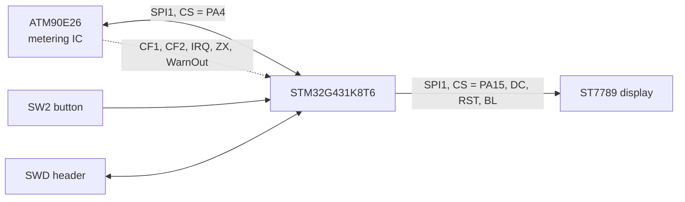
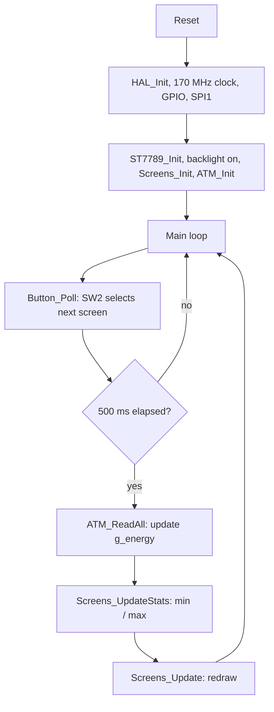

# Legatronics – Firmware

Firmware for the **Legatronics** single-phase energy meter. It runs on an **STM32G431K8T6**, reads voltage, current, power, frequency and energy from an **ATM90E26** metering IC over SPI, and shows the results on an **ST7789** colour display. A push button switches between four screens.

The hardware and PCB are documented separately in the project documentation (schematic, PCB layout, block diagram).

## Features

- Live measurement of RMS voltage, RMS current, active power, line frequency and accumulated active energy
- Four display screens: **Voltage**, **Current**, **Power**, **Energy**
- Arc gauges, sparkline history graphs and running min / max values
- Partial screen refresh to keep the display responsive
- Single push button (`SW2`) to change screens, with software debounce
- Built-in self-test suite for the ATM90E26 link and scaling code
- 170 MHz core clock from the 8 MHz crystal

## System overview



Both SPI devices share one bus (`SPI1`) and are selected with separate chip-select lines.

## Hardware

| Item | Value |
|---|---|
| MCU | STM32G431K8T6 (Cortex-M4F, LQFP32) |
| Flash / RAM | 64 KB / 32 KB |
| Metering IC | ATM90E26 (SPI) |
| Display | ST7789 (SPI), 1.3" module |
| External crystal | 8 MHz (HSE, PLL source) |
| Debug | SWD (PA13 / PA14) |

## Pin map

| Pin | Label | Mode | Function |
|---|---|---|---|
| PA0 | `WarnOut` | Input | ATM90E26 warning output |
| PA1 | `CF1` | Input | ATM90E26 active energy pulse output |
| PA2 | `CF2` | Input | ATM90E26 reactive energy pulse output |
| PA3 | `IRQ` | Input | ATM90E26 interrupt output |
| PA4 | `CS_ATM90E26` | Output (idle high) | ATM90E26 chip select |
| PA5 | `SPI1_SCK` | SPI1 | Shared SPI clock |
| PA6 | `SPI1_MISO` | SPI1 | Shared SPI data in |
| PA7 | `SPI1_MOSI` | SPI1 | Shared SPI data out |
| PA8 | `ZX` | Input | ATM90E26 zero-crossing output |
| PA13 | `SWDIO` | SYS | Serial Wire Debug |
| PA14 | `SWCLK` | SYS | Serial Wire Debug |
| PA15 | `CS_ST7789` | Output (idle high) | Display chip select |
| PB0 | `Reset_ATM` | Output (idle high) | ATM90E26 hardware reset |
| PB3 | `DC_ST7789` | Output | Display data / command select |
| PB4 | `Reset_ST7789` | Output | Display reset |
| PB5 | `BL_ST7789` | Output | Display backlight |
| PB7 | `SW2` | Input (pull-up) | Screen-change button (active low) |
| PF0 / PF1 | `OSC_IN` / `OSC_OUT` | RCC | 8 MHz crystal |

## Firmware architecture

| Module | Files | Responsibility |
|---|---|---|
| Application | `main.c` | Initialisation, 500 ms measurement loop, button handling |
| Metering driver | `atm90e26.c/.h` | ATM90E26 register access, configuration, scaling to physical units |
| Display driver | `st7789.c/.h` | ST7789 initialisation, pixels, lines, rectangles, circles, arcs, text |
| UI | `screens.c/.h` | The four screens, sparkline history, min / max tracking |
| Fonts | `font.c/.h` | Bitmap fonts: 7×10, 11×18, 16×26 |
| Self-test | `tests.c/.h` | Hardware and scaling checks, results shown on the display and printed |
| Platform | `stm32g4xx_hal_msp.c`, `stm32g4xx_it.c`, `system_stm32g4xx.c`, `syscalls.c`, `sysmem.c` | CubeMX-generated HAL, interrupt and newlib support |

All measurements are stored in one global structure, `g_energy` (`EnergyData_t`), which the metering driver writes and the UI reads.

### Program flow



The application is a simple polled super-loop: no RTOS and no application interrupts. `SysTick` provides the 1 ms time base used for scheduling and debouncing.

## ATM90E26 driver

### Initialisation

`ATM_Init()` performs the following steps:

1. Pulses the hardware reset pin (`PB0`) low for 5 ms and waits 200 ms.
2. Sends a software reset command.
3. Writes the configuration registers: function enable, sag threshold, metering mode (`MMode`), PL constant and start / no-load thresholds.
4. Writes the metering calibration block and the measurement calibration block, each after its unlock key (`0x5678`).
5. Resets the running min / max statistics.

> **Calibration:** gains and offsets are currently set to the datasheet defaults. They must be calibrated for your voltage divider and current sensor before the readings can be trusted.

### Reading and scaling

`ATM_ReadAll()` reads the measurement registers and converts them to physical units:

| Quantity | Conversion |
|---|---|
| Voltage (RMS) | `raw × 0.01` V |
| Current (RMS) | `raw × 0.001` A |
| Active power | signed `raw`, 1 LSB = 1 W (negative values are clamped to 0) |
| Frequency | `raw × 0.01` Hz |
| Active energy | `raw × 0.03125` Wh, accumulated on every read |

The energy factor assumes the default meter constant of 3200 imp/kWh.

### SPI protocol

Each register access is a 3-byte frame: an address byte (bit 7 set for reads) followed by 16 data bits, MSB first.

## Shared SPI bus

The ATM90E26 and the ST7789 need different SPI settings, so the driver reconfigures `SPI1` around every metering access:

| Device | Clock polarity / phase | Prescaler | Approx. SCK |
|---|---|---|---|
| ST7789 display (default) | CPOL = 0, CPHA = 0 (mode 0) | 8 | 10.6 MHz |
| ATM90E26 | CPOL = 1, CPHA = 1 (mode 3) | 256 | 332 kHz |

For each metering transaction the driver waits for the bus to become idle, switches `SPI1` to the ATM90E26 settings, runs the transfer with only `CS_ATM90E26` low, then restores the display settings. Both chip-select pins are driven high at start-up, so neither device is selected until it is addressed.

## User interface

The display uses a four-screen layout. Press `SW2` (`PB7`) to cycle **Voltage → Current → Power → Energy → Voltage …**

| Screen | Content |
|---|---|
| Voltage | Arc gauge, history graph, frequency badge, min / max / average |
| Current | Double arc gauge, history graph, RMS badge, min / max / RMS |
| Power | Arc gauge (0–5000 W), power-factor badge, history graph, active / reactive / apparent power |
| Energy | Energy value with progress bar (0–10 kWh), session time, history graph |

- Changing screens triggers a **full redraw**; subsequent updates only repaint the dynamic regions.
- Every screen keeps its own history buffer, which is filled on every update regardless of which screen is visible.
- The top bar shows the screen name and a page indicator.

## Self-tests

`tests.c` contains a self-test suite, started with `Run_Tests()` (the call is currently commented out in `main.c`):

| Test | Checks |
|---|---|
| `Test_SPI_Comms` | Register write / read-back over SPI |
| `Test_CS_Pin` | Chip-select line and `SysStatus` register |
| `Test_Voltage`, `Test_Current` | Readings in range and raw-to-unit scaling |
| `Test_Power` | Apparent power, power factor and phase angle |
| `Test_Energy_Accumulation` | Energy register and accumulation maths |
| `Test_MinMax_Tracking` | Min / max logic |

Each result is shown on the display as `OK` / `XX` and printed with `printf`, followed by a pass count summary. `ATM_CheckStatus()` prints the `SysStatus` register for quick debugging.

> **Debug output:** `printf` goes through `_write()` in `syscalls.c`, which calls `__io_putchar()`. Implement `__io_putchar()` (for example with `ITM_SendChar()` for SWO) and enable SWV in the debug configuration to see the output.

## Clock configuration

The 8 MHz crystal is the PLL source.

```
HSE 8 MHz ──/2──► 4 MHz ──×85──► 340 MHz VCO ──/2──► SYSCLK 170 MHz
```

| Clock | Frequency |
|---|---|
| SYSCLK / HCLK | 170 MHz (voltage scale 1 boost, 4 flash wait states) |
| APB1 / APB2 | 85 MHz |

## Peripherals

- **SPI1** – master, full duplex, 8-bit, MSB first, software chip select. Mode and speed are switched at run time (see above).
- **GPIO** – chip selects, display control lines and the ATM90E26 reset are outputs. The ATM90E26 status lines (`CF1`, `CF2`, `IRQ`, `ZX`, `WarnOut`) and `SW2` are plain inputs; no EXTI interrupts are enabled.
- **SysTick** – 1 ms HAL time base.
- **SWD** – programming and debugging.

> **Note:** the PCB also routes USB (Virtual COM Port) to the MCU, but USB is not enabled in this firmware yet.

## Memory layout

From `STM32G431K8TX_FLASH.ld`:

| Region | Origin | Size |
|---|---|---|
| FLASH | `0x08000000` | 64 KB |
| RAM | `0x20000000` | 32 KB |

Minimum heap is `0x200` (512 B) and minimum stack is `0x400` (1 KB). The bitmap fonts are stored in flash.

## Repository structure

```
Core/
  Inc/                        main.h, atm90e26.h, st7789.h, screens.h, font.h, tests.h, ...
  Src/
    main.c                    Application and main loop
    atm90e26.c                Metering IC driver
    st7789.c                  Display driver
    screens.c                 UI screens
    font.c                    Bitmap fonts
    tests.c                   Self-test suite
    stm32g4xx_it.c            Interrupt handlers
    stm32g4xx_hal_msp.c       HAL MSP (SPI1 pins and clocks)
    system_stm32g4xx.c        CMSIS system init
    syscalls.c, sysmem.c      newlib support
Drivers/                      STM32G4 HAL and CMSIS (generated)
Display_Screens.ioc           STM32CubeMX configuration
STM32G431K8TX_FLASH.ld        Linker script
Display_Screens.launch        Run configuration
Display_Screens_Debug.launch  Debug configuration
```

## Toolchain

| Tool | Version |
|---|---|
| STM32CubeIDE | any recent version |
| STM32CubeMX | 6.16.1 |
| STM32Cube FW_G4 | V1.6.2 |
| Compiler | GCC (arm-none-eabi) |

## Build and flash

1. Clone the repository.
2. In STM32CubeIDE choose **File → Import → Existing Projects into Workspace** and select the repository folder.
3. Build with **Project → Build All**.
4. Connect a debug probe to the SWD header (`GND`, `SWCLK`, `SWDIO`, `NRST`, `+3V3`).
5. Use the `Display_Screens_Debug` launch configuration to flash and debug.

To enter the system bootloader instead, hold the `BOOT0` button while pressing `NRST`.

## Modifying the hardware configuration

Open `Display_Screens.ioc` in STM32CubeMX (or CubeIDE) and regenerate. Code between the `USER CODE BEGIN` / `USER CODE END` markers is preserved.

## Roadmap

- Calibrate voltage and current gains and offsets for the final hardware
- Enable USB Virtual COM Port for logging
- Use the `ZX`, `CF1`, `CF2` and `IRQ` lines with EXTI interrupts instead of polling
- Speed up display drawing with buffered transfers or DMA

## License

Add your license here.
