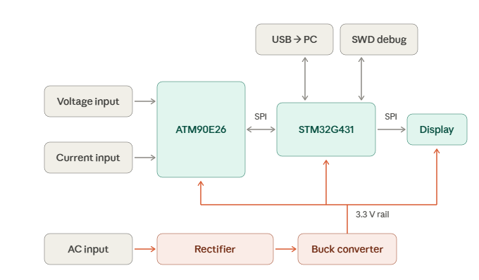
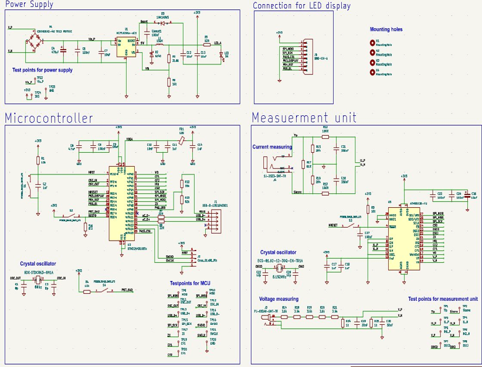
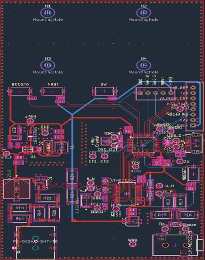
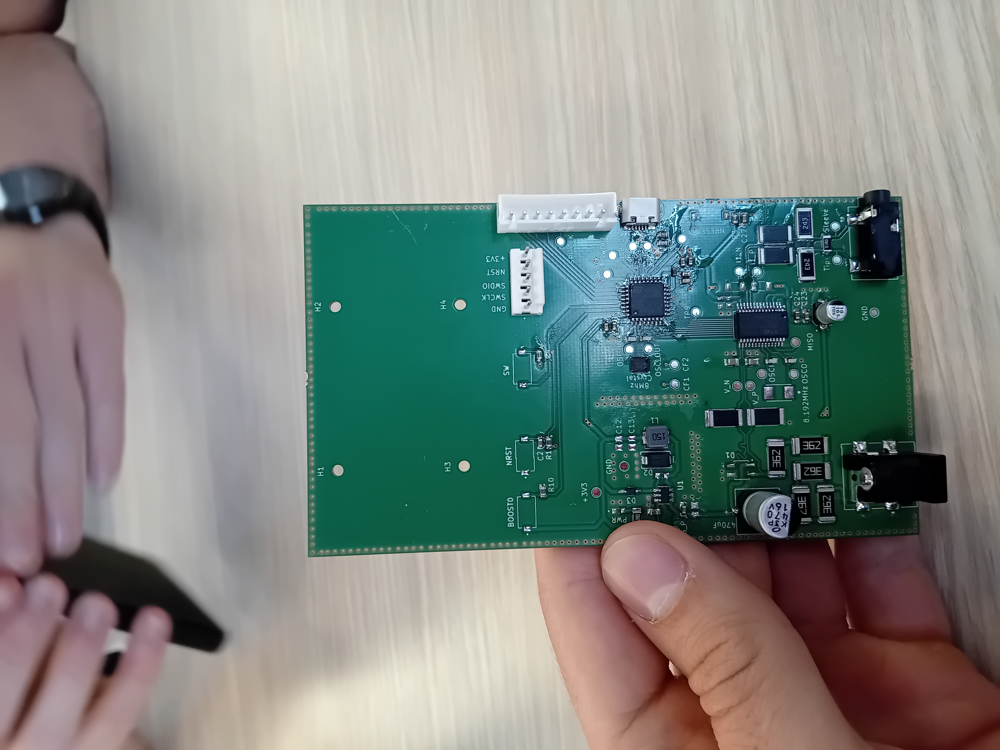

# Electrical Measuring System

The PCB was designed in KiCad and firmware was written in STM32CubeIDE. The goal of this project is to develop a device that can measure AC/DC voltage, AC frequency, active power and active energy consumption. This PCB has two layers(signal and ground). 

## Block diagram

The system is divided in 4 sub-systems.

<p align = "center">
  
</p>

It consists of the following :

- Power supply section
- Microcontroller STM32
- Measuring chip ATM90E26
- OLED Diplay

SPI communication is used for ATM90E26 and OLED display. SWD is used for microcontroller programming. A buck converter is used for power supply

## PCB and Schematic in KiCad

<p align="center">
  
  
</p>

# Firmware

Firmware runs on an **STM32G431K8T6**, reads AC frequency, active power and active energy consumption from an **ATM90E26** metering IC over SPI, and shows the results on an colour display. A push button switches between four screens.

## Firmware architecture

| Module | Files | Responsibility |
|---|---|---|
| Application | `main.c` | Initialisation, 500 ms measurement loop, button handling |
| Metering driver | `atm90e26.c/.h` | ATM90E26 register access, configuration, scaling to physical units |
| Display driver | `st7789.c/.h` | ST7789 initialisation, pixels, lines, rectangles, circles, arcs, text |
| UI | `screens.c/.h` | The four screens, sparkline history, min / max tracking |
| Fonts | `font.c/.h` | Bitmap fonts: 7×10, 11×18, 16×26 |
| Platform | `stm32g4xx_hal_msp.c`, `stm32g4xx_it.c`, `system_stm32g4xx.c`, `syscalls.c`, `sysmem.c` | CubeMX-generated HAL, interrupt and newlib support |

All measurements are stored in one global structure, `g_energy` (`EnergyData_t`), which the metering driver writes and the UI reads.

## Repository structure

```
Core/
  Inc/                        main.h, atm90e26.h, st7789.h, screens.h, font.h, tests.h, ...
  Src/
    main.c                    Application and main loop
    atm90e26.c                Metering IC driver
    st7789.c                  Display driver
    screens.c                 UI screens
    font.c                    Bitmap fonts
    tests.c                   Self-test suite
    stm32g4xx_it.c            Interrupt handlers
    stm32g4xx_hal_msp.c       HAL MSP (SPI1 pins and clocks)
    system_stm32g4xx.c        CMSIS system init
    syscalls.c, sysmem.c      newlib support
Drivers/                      STM32G4 HAL and CMSIS (generated)
Display_Screens.ioc           STM32CubeMX configuration
STM32G431K8TX_FLASH.ld        Linker script
Display_Screens.launch        Run configuration
Display_Screens_Debug.launch  Debug configuration
```

## Testing

<p align="center">
  
  
</p>


